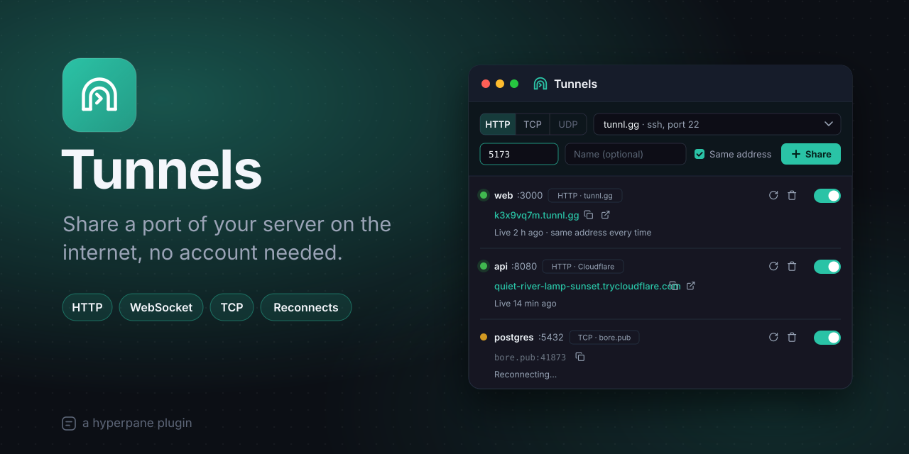

# Tunnels

Share a port of your server on the internet, no account needed. Type a
port, press Share, and get a public address for your web app, your API, a
webhook endpoint or a database. Tunnels run on the server, so they keep
going when you close the app, and they reconnect by themselves when the
network blinks.

## Features

- **HTTP and WebSocket:** an `https://` address for a web app or an API;
  WebSockets go through too. Click the address to open it.
- **TCP:** a host and a port for anything else on TCP: a database, ssh, a
  game server.
- **Four services, no sign-up:** tunnl.gg, Pinggy, Cloudflare quick
  tunnels and bore.pub. Pick the one that suits your network.
- **The same address every time** (tunnl.gg): the address survives
  reconnects, so a webhook you set up keeps working.
- **Always on:** a tunnel you leave on starts again with the plugin, and
  one that drops reconnects after 2, 5, 10, 30, then every 60 seconds.
- **Knows when nothing answers:** a tunnel says **nothing listening** while
  nothing runs on its port yet.
- **Any machine the server reaches:** share `3000` on the server itself, or
  `192.168.1.20:3000` on another machine it can see.

## How to use

1. Open a project, then open Tunnels: **+** on the project, **New
   tunnels**, or right-click the canvas.
2. Pick what it carries (**HTTP** or **TCP**) and a service.
3. Type the port (`3000`), give it a name if you like, and press
   **Share**.
4. Copy the address with the button beside it, or click it to open it in
   your browser.
5. Use the switch to turn a tunnel off and on, **Restart** to reconnect it,
   and **Remove** to forget it.

## The services

| Service | HTTP + WebSocket | TCP | Goes out through | Needs |
| --- | --- | --- | --- | --- |
| [tunnl.gg](https://tunnl.gg) | ✓ (same address possible) | | ssh, port 22 | ssh |
| [Pinggy](https://pinggy.io) | ✓ | ✓ | ssh, port 443 | ssh |
| [Cloudflare](https://developers.cloudflare.com/cloudflare-one/networks/connectors/cloudflare-tunnel/do-more-with-tunnels/trycloudflare/) quick tunnels | ✓ | | HTTPS, port 443 | cloudflared (downloaded once) |
| [bore.pub](https://github.com/ekzhang/bore) | | ✓ | TCP port 7835 | nothing |

- **tunnl.gg:** browsers see a warning page first (once a day; once a week
  for a stable address); curl and webhooks don't. 3 tunnels at once, 5 GB
  a day, 24 hours per connection.
- **Pinggy:** free connections last 60 minutes; it reconnects, with a new
  address.
- **Cloudflare:** no warning page; at most 200 requests at once, no
  Server-Sent Events; a new address each time.
- **bore.pub:** doesn't encrypt. Use it for what encrypts itself (ssh, TLS)
  or doesn't matter.

## Good to know

- **Anyone with an address reaches the port.** Share only what's meant to
  be seen.
- **On a VPN or a strict network**, pick a service that goes out on port
  443 (Pinggy, Cloudflare): ports 22 and 7835 are often blocked.
- **UDP** is shown but can't be picked yet: no free service carries it
  without an account or its own app (Pinggy's UDP needs its CLI).
- **Connecting** has 30 seconds to get an address. A tunnel that never got
  through since you turned it on (a timeout, a refused connection, a host
  that can't be found, a changed host key, a missing program) **stops** and
  says why; **Restart** tries again. One that was live and drops keeps
  reconnecting.
- Each project has its own tunnels. Turning Tunnels off in a project
  stops its tunnels; those left on start again when you turn it back on.
- A server keeps at most 20 tunnels.
- Removing a tunnel with the same address forgets its key: a new tunnel
  gets a new address.

## How it works

The server part keeps the tunnels in its data folder
(`<server data>/plugins/tunnels/tunnels.json`): they're this server's,
listed by project, and never written into the project's folder. Each one that's on is one session of its service: an
`ssh`, a `cloudflared`, or a bore connection the plugin speaks itself.

The ssh ones use none of your ssh setup (not `~/.ssh/config`, your keys or
your agent): each tunnel has its own Ed25519 key, made by the plugin, in
`keys/`, readable by you only, and the services' host keys are remembered
in the plugin's own `known_hosts`. If one ever changes, the tunnel stops
instead of connecting. tunnl.gg's same address is made from the tunnel's
own key.

cloudflared is the server's own if it's on its PATH; else version
2026.10.6 is downloaded once from Cloudflare's GitHub releases into the
plugin's data folder, and used only if its SHA-256 is the one Cloudflare
published. It runs with `--protocol http2` (port 443, not QUIC) and a home
of its own (a `~/.cloudflared/config.yml` would stop quick tunnels).

While a tunnel is on, the server part counts as busy, so it isn't stopped
for being idle. Its log (Logs, on its page in Plugins) says when each
session starts and ends, and what it said.

Another service is a file in `src/server/providers/` and a line in its
`index.ts`.

## Develop

```sh
./build.sh --test     # types, plugin.json, and the tests (stand-ins for ssh, cloudflared and bore.pub)
```

## License

MIT, © 2026 Astralyx. See [LICENSE](LICENSE).
